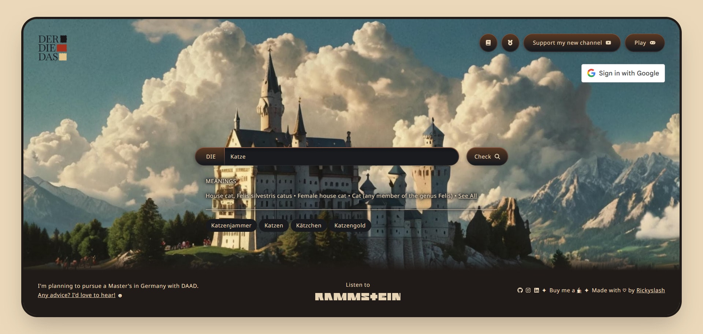
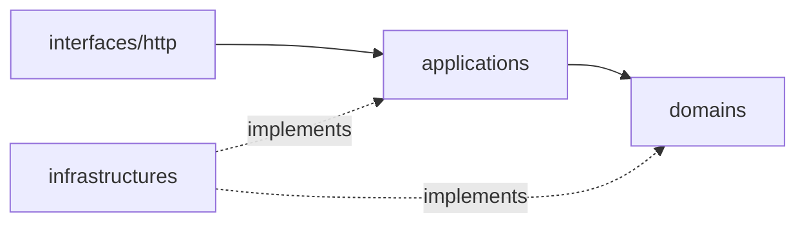

<p align="center">
  
</p>

<h1 align="center">DerDieDas</h1>

<p align="center">
  Learn German noun genders — search 88K+ nouns or play the ranked guessing game.
</p>

<p align="center">
  <a href="https://github.com/ricky-kiva/wrx-derdiedas-be/actions/workflows/ci-pr.yaml"></a>
  <a href="https://nodejs.org/"></a>
  <a href="https://www.typescriptlang.org/"></a>
  <a href="https://expressjs.com/"></a>
  <a href="https://www.mongodb.com/"></a>
  <a href="https://redis.io/"></a>
</p>

DerDieDas is a German noun-gender trainer. Search a noun to see its article (`der`, `die`, `das`), meanings, and similar words, or play the ranked guessing game and climb the global leaderboard.

This repository contains the backend only. The frontend lives in the [frontend repository](https://github.com/ricky-kiva/wrx-derdiedas-fe).

## Features

- **Noun search** — `POST /search` with `{ "word": "..." }` fuzzy-matches the normalized noun corpus through Fuse.js.
- **Endless rounds** — `GET /game/token` issues the value for the `x-game-token` header. `POST /game/start` deals 10 random nouns: correct answers add 10 points, wrong answers subtract 5 (floor 0), and 10 new nouns arrive once the set is exhausted. Game state lives in Redis for one hour.
- **Guest and signed-in play** — a game starts with or without a bearer token. `POST /game/:id/end` saves a guest score under a required name (max 30 characters); games ending at 0 points are discarded.
- **Google sign-in** — `POST /auth/login` verifies a Google ID token, creates the user on first sign-in, and returns an access JWT with an `httpOnly`, `SameSite=Strict` refresh cookie. `POST /auth/refresh-token` rotates both tokens; `POST /auth/logout` deletes the Redis-stored refresh token.
- **Leaderboard** — `GET /leaderboard?page=&limit=` returns positive scores ranked by points, then latest update (`limit` 10–150, default 25). `POST /leaderboard` submits a score.
- **Score decay** — a daily 02:30 cron subtracts 5 points (minimum 0) from players inactive for 7+ days and deletes anonymous profiles at 5 points or less.
- **Profile** — `GET /users/:id/points` reads a score, `PATCH /users/me` renames, and `DELETE /users/me` deletes the profile and its score.

## Preview

<p align="center">
  
</p>

## Quick Start

**Requirements:** Node.js 22, MongoDB 8, Redis 7.4.

```bash
npm install
# create .env (see the variables below)
npm run dev
```

**Environment**

- `.env` and `.test.env` are untracked; `NODE_ENV=test` reads `.test.env`, otherwise `.env`.
- A missing required variable aborts boot with `Missing environment variable: <name>`; only `REDIS_PORT` has a fallback.
- `NODE_ENV=production` binds `0.0.0.0`; every other value binds `localhost`.

| Variable | Purpose |
|---|---|
| `NODE_ENV` | `development`, `production` or `test` |
| `PORT` | HTTP port (no fallback) |
| `GOOGLE_CLIENT_ID` | OAuth client ID; also the expected audience of Google ID tokens |
| `MONGO_HOST`, `MONGO_PORT`, `MONGO_DATABASE`, `MONGO_USER`, `MONGO_PASSWORD` | MongoDB connection |
| `REDIS_HOST`, `REDIS_PORT`, `REDIS_DATABASE`, `REDIS_PASSWORD` | Redis connection and refresh-token store (`REDIS_PORT` defaults to `6379`) |
| `JWT_ACCESS_TOKEN_SECRET`, `JWT_REFRESH_TOKEN_SECRET` | Secrets for the user tokens |
| `JWT_ACCESS_TOKEN_EXPIRY`, `JWT_REFRESH_TOKEN_EXPIRY` | Lifetimes in seconds |
| `GAME_JWT_ACCESS_TOKEN_SECRET`, `GAME_JWT_ACCESS_TOKEN_EXPIRY` | Secret and lifetime for game tokens |

**Docker:** `docker compose up --build` runs the API with MongoDB and Redis, reading `.env`, `.mongo.env` and `.redis.env`.

## Commands

| Command | Description |
|---|---|
| `npm run dev` | Start the API with `ts-node-dev` |
| `npm run tsc` | Compile TypeScript to `build/` |
| `npm start` | Run the compiled server (`build/app.js`) |
| `npm test` | Run the Jest suite |
| `npm run test-coverage` | Run Jest with coverage |
| `npm run lint` | Run ESLint |

## Architecture

Clean Architecture: dependencies point inward, from delivery to domain.



| Layer | Path | Responsibility |
|---|---|---|
| Domain | `src/domains/` | Entities and repository contracts per aggregate (`game`, `noun`, `nounSetMetadata`, `user`, `userPoint`); no outward imports |
| Application | `src/applications/` | Use cases, ports (`security`, `logger`, `auth`, `search`) and read-model query repositories; depends only on domain and `commons` |
| Infrastructure | `src/infrastructures/` | Adapters implementing domain repository contracts and application ports: Mongoose, Redis, JWT, Google auth, Winston, Fuse.js, decay cron |
| Interface | `src/interfaces/http/` | Express routers, handlers, Zod validation adapters and CORS, Helmet, logging, 404 and error middleware |
| Shared kernel | `src/commons/` | Config, exceptions, shared types, DI tokens and the CORS whitelist; no business rules |

`tsyringe` wires the graph in `src/infrastructures/container.ts` (composition root; tokens in `src/commons/DITokens.ts`). Requests flow `route → handler → use case → repository contract → adapter`; errors are normalized by `src/interfaces/http/middlewares/error/errorPreResponse.ts` into `{ status, message }` or `{ status, data }`.

© 2026 Ricky Fadel M. All rights reserved.