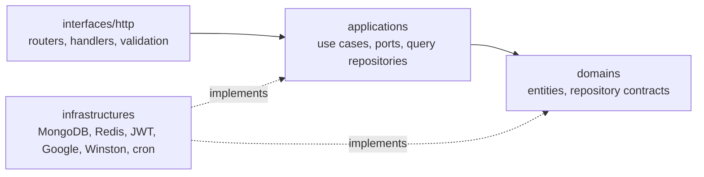

<p align="center">
  
</p>

<h1 align="center">DerDieDas</h1>

<p align="center">
  Learn German noun genders — search 88K+ nouns or play the ranked guessing game.
</p>

<p align="center">
  <a href="https://github.com/ricky-kiva/wrx-derdiedas-be/actions/workflows/ci-pr.yaml"></a>
  <a href="https://nodejs.org/"></a>
  <a href="https://www.typescriptlang.org/"></a>
  <a href="https://expressjs.com/"></a>
  <a href="https://www.mongodb.com/"></a>
  <a href="https://redis.io/"></a>
</p>

DerDieDas is a German noun-gender trainer. Search a noun to see its article (`der`, `die`, `das`), meanings, and similar words, or play the ranked guessing game and climb the global leaderboard.

This repository contains the frontend only. The API lives in the [frontend repository](https://github.com/ricky-kiva/wrx-derdiedas-fe).

## Features

- **Google sign-in.** `POST /auth/login` verifies a Google ID token and creates the user on first sign-in. It returns an access JWT and writes the refresh token to an `httpOnly`, `SameSite=Strict` cookie. `POST /auth/refresh-token` rotates both tokens; refresh tokens are stored in Redis, and `POST /auth/logout` deletes the stored one.
- **Endless game rounds.** `GET /game/token` issues a game token sent as `x-game-token`. `POST /game/start` deals 10 random nouns; a correct answer adds 10 points and a wrong one subtracts 5, with the score floored at 0. When the dealt nouns are used up, the next 10 arrive with the answer response. Game state lives in Redis for one hour.
- **Guest and signed-in play.** A game can start without a bearer token. `POST /game/:id/end` saves a guest score under a required name (max 30 characters); games that end at 0 points are discarded.
- **Leaderboard.** `GET /leaderboard?page=&limit=` ranks positive scores by points and last update (`limit` is clamped to 10–150, default 25). `POST /leaderboard` submits a score.
- **Fuzzy noun search.** `POST /search` with `{ "word": "..." }` matches the normalized noun corpus through Fuse.js.
- **Score decay.** A cron job at 02:30 server time reduces the score of players inactive for 7 days or more by 5 points (or to zero if the score is lower) and deletes anonymous profiles whose score is 5 or lower.
- **Profile and score.** `GET /users/:id/points` reads a score, `PATCH /users/me` renames, and `DELETE /users/me` removes the profile and its score.

## Preview

<p align="center">
  
</p>

## Quick Start

Requires Node.js 22, MongoDB 8 and Redis 7.4.

```bash
# create .env and fill in the variables listed below

npm install
npm run dev
```

Environment variables are read from `.env` (`NODE_ENV=test` reads `.test.env` instead). The files are not tracked in git. A missing required variable aborts the boot with `Missing environment variable: <name>`; only the ones noted below have a fallback. `NODE_ENV` also selects the bind host — `production` listens on `0.0.0.0`, anything else on `localhost`.

| Variable | Purpose |
|---|---|
| `NODE_ENV` | `development`, `production` or `test` |
| `PORT` | HTTP port (no fallback) |
| `GOOGLE_CLIENT_ID` | OAuth client ID; also the expected audience of Google ID tokens |
| `MONGO_HOST`, `MONGO_PORT`, `MONGO_DATABASE`, `MONGO_USER`, `MONGO_PASSWORD` | MongoDB connection |
| `REDIS_HOST`, `REDIS_PORT`, `REDIS_DATABASE`, `REDIS_PASSWORD` | Redis connection and refresh-token store (`REDIS_PORT` defaults to `6379`) |
| `JWT_ACCESS_TOKEN_SECRET`, `JWT_REFRESH_TOKEN_SECRET` | Secrets for the user tokens |
| `JWT_ACCESS_TOKEN_EXPIRY`, `JWT_REFRESH_TOKEN_EXPIRY` | Lifetimes in seconds |
| `GAME_JWT_ACCESS_TOKEN_SECRET`, `GAME_JWT_ACCESS_TOKEN_EXPIRY` | Secret and lifetime for game tokens |

The whole stack (API, MongoDB, Redis) can also run through Docker: `docker compose up --build`, which reads `.env`, `.mongo.env` and `.redis.env`.

## Commands

| Command | Description |
|---|---|
| `npm run dev` | Start the API with `ts-node-dev` |
| `npm run tsc` | Compile TypeScript to `build/` |
| `npm start` | Run the compiled server (`build/app.js`) |
| `npm test` | Run the Jest suite |
| `npm run test-coverage` | Run Jest with coverage |
| `npm run lint` | Run ESLint |

## Architecture

This repository follows Clean Architecture. Dependencies point inward: a layer may depend on the layers closer to the domain, never on the layers further out.



- `src/domains/` — the innermost layer: entities and repository contracts per aggregate (`game`, `noun`, `nounSetMetadata`, `user`, `userPoint`). It imports nothing outside `src/domains/`.
- `src/applications/` — use cases, the ports they depend on (`security`, `logger`, `auth`, `search`) and read-model query repositories. It depends only on `src/domains/` and `src/commons/`.
- `src/infrastructures/` — adapters that implement the domain repository contracts and application ports: Mongoose/MongoDB, Redis (game state and refresh-token store), JWT, Google ID-token verification, Winston logging, Fuse.js search and the point-decay cron.
- `src/interfaces/http/` — the delivery layer: Express routers, handlers, Zod validation adapters and middlewares (CORS, Helmet, request logging, 404, error normalization).
- `src/commons/` — shared kernel: config loading, exceptions, shared types, DI tokens and the CORS whitelist. It holds no business rules and is used by the application, infrastructure and interface layers.

`tsyringe` builds the object graph in `src/infrastructures/container.ts`, the composition root (tokens live in `src/commons/DITokens.ts`). Requests flow `route → handler → use case → repository contract → adapter`, and errors are normalised by `src/interfaces/http/middlewares/error/errorPreResponse.ts` into the `{ status, message }` / `{ status, data }` envelope.

© 2026 Ricky Fadel M. All rights reserved.